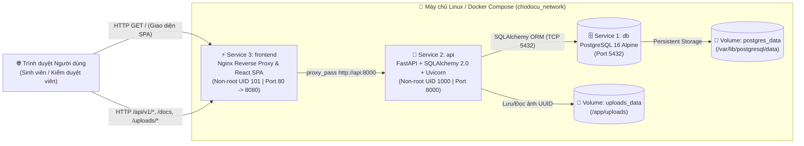
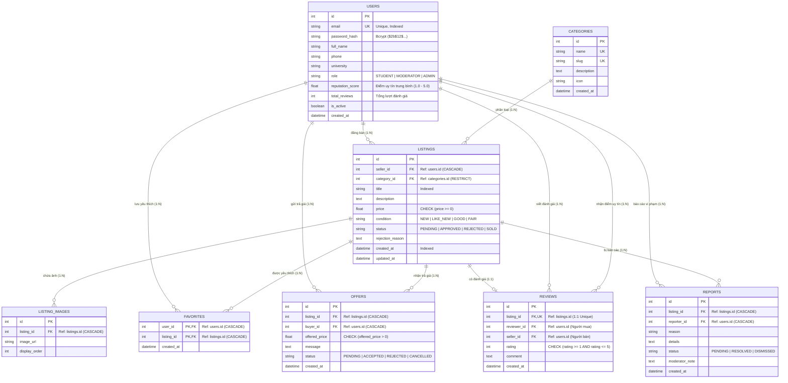

# 🎓 Chợ Đồ Cũ Sinh Viên (`chodocusinhvien`)

[](https://fastapi.tiangolo.com/)
[](https://react.dev/)
[](https://www.postgresql.org/)
[](https://docs.docker.com/compose/)
[](#5-kiểm-thử-tự-động--bảo-đảm-chất-lượng-qa)
[](./LICENSE)

> **Đồ án Nhóm (Capstone) — Đánh giá 2 (ĐG2) Học phần Lập trình Mã nguồn mở (`POS02024`)**  
> Nền tảng thương mại điện tử C2C chuyên biệt giúp sinh viên trao đổi, mua bán lại giáo trình, đồ điện tử, đồ gia dụng phòng trọ, bàn ghế và phương tiện di chuyển một cách minh bạch, có kiểm duyệt nội dung và đánh giá điểm uy tín sau giao dịch.

---

## 1. Thông tin Học phần, Đề tài & Phân công Nhóm 4

### 1.1. Thông tin chung
- **Trường / Khoa:** Trường Đại học Quản lý và Công nghệ Hải Phòng (HPU) – Khoa Công nghệ Thông tin
- **Học phần:** Lập trình mã nguồn mở (Mã học phần: `POS02024`) – Đánh giá 2 (ĐG2)
- **Đề tài:** **Đề tài số 4 — Chợ đồ cũ sinh viên (`chodocusinhvien`)**
- **Tên nhóm & Lớp:** **Nhóm 4 – Lớp CT2802**
- **Giảng viên hướng dẫn:** **ThS. Đỗ Văn Tuyên**
- **Kho lưu trữ GitHub:** [`https://github.com/FALLEN-ALBAZ/chodocusinhvien`](https://github.com/FALLEN-ALBAZ/chodocusinhvien)

### 1.2. Bảng Phân công Vai trò & Tỷ lệ Đóng góp (4 Thành viên)

| TT | Họ và tên | Vai trò chính | Phân hệ phụ trách chi tiết | Minh chứng trong Kho GitHub | Tỷ lệ đóng góp |
| :-: | :--- | :--- | :--- | :--- | :-: |
| **1** | **Nguyễn Hải Long** *(Trưởng nhóm)* | **Trưởng nhóm & DevOps** | Lập kế hoạch dự án, quản lý GitHub Projects & nhánh Git; thiết kế cấu trúc Monorepo; viết `Dockerfile` non-root (`appuser` UID 1000 & `nginx` UID 101), `docker-compose.yml` (3 dịch vụ + healthcheck + persistent volumes), cấu hình Nginx Reverse Proxy, thiết lập GitHub Actions CI/CD (`.github/workflows/ci.yml`) và tích hợp hệ thống cuối cùng. | [`docker-compose.yml`](./docker-compose.yml), [`backend/Dockerfile`](./backend/Dockerfile), [`frontend/Dockerfile`](./frontend/Dockerfile), [`nginx/nginx.conf`](./nginx/nginx.conf), [`.github/workflows/ci.yml`](./.github/workflows/ci.yml), [`.env.example`](./.env.example) | **25%** |
| **2** | **Nguyễn Đức Anh** | **Back-end API & Bảo mật** | Thiết kế & hiện thực hóa 25 RESTful API endpoints bằng FastAPI; cơ chế xác thực JWT (`HS256`) và băm mật khẩu `bcrypt`; phân quyền RBAC 3 cấp độ (`STUDENT`, `MODERATOR`, `ADMIN`); kiểm chứng dữ liệu Pydantic v2; hiện thực các quy tắc nghiệp vụ nâng cao (Upload đa ảnh UUID, giới hạn 5 tin/ngày chống spam `429`, giao dịch nguyên tử chốt đơn `SOLD`, Structured JSON Logging Middleware) & tài liệu OpenAPI/Swagger. | [`backend/app/main.py`](./backend/app/main.py), [`backend/app/security/`](./backend/app/security/), [`backend/app/routers/`](./backend/app/routers/), [`backend/app/schemas/`](./backend/app/schemas/) | **25%** |
| **3** | **Nguyễn Huy Hoàng** | **Front-end UI/UX** | Thiết kế & phát triển giao diện Single Page Application (SPA) bằng React 18 + Vite + TailwindCSS; tích hợp tầng giao tiếp RESTful API & quản lý JWT phía client; xây dựng Thanh chuyển đổi nhanh 1-Click 3 Tác nhân Demo, màn hình Khám phá/Lọc/Phân trang, Đăng tin đa ảnh, Quản lý giao dịch, Bàn làm việc Kiểm duyệt viên và **Trạm Kiểm thử Trực quan 8 Bước Bảo vệ ĐG2 (`DefenseLabView`)**. | [`frontend/src/App.jsx`](./frontend/src/App.jsx), [`frontend/src/api.js`](./frontend/src/api.js), [`frontend/src/components/`](./frontend/src/components/), [`frontend/vite.config.js`](./frontend/vite.config.js) | **25%** |
| **4** | **Hoàng Nhật Thắng** | **CSDL & Kiểm thử (QA)** | Thiết kế sơ đồ thực thể liên kết ERD 8 bảng đạt chuẩn 3NF (quan hệ `1:N`, `N:N`, `1:1`); lập trình SQLAlchemy 2.0 ORM Models kèm `CheckConstraint`; cấu hình Alembic Migration (`upgrade`/`downgrade`); viết kịch bản dữ liệu mẫu idempotent (`seed.py`); xây dựng bộ 18 bài kiểm thử tự động `pytest` (đạt độ bao phủ **94.37%**) và bộ Postman Collection Runner (24 requests). | [`backend/app/models/`](./backend/app/models/), [`backend/alembic/`](./backend/alembic/), [`backend/app/seed.py`](./backend/app/seed.py), [`backend/tests/`](./backend/tests/), [`postman/`](./postman/) | **25%** |
| **Tổng** | **4 Thành viên** | **Full-stack Team** | **Hoàn thành 100% yêu cầu bắt buộc & toàn bộ các tính năng nâng cao của Đề tài 4** | **100% Commits & PRs minh bạch** | **100%** |

---

## 2. Kiến trúc Hệ thống & Danh mục Công nghệ Mã nguồn mở

### 2.1. Sơ đồ Kiến trúc Triển khai Container (3 Services)

Hệ thống được đóng gói hoàn chỉnh theo mô hình 3 tầng chạy trong mạng nội bộ Docker (`chodocu_network`), đảm bảo mọi luồng truy cập từ trình duyệt của người dùng đều đi qua cổng điều phối của **Nginx Reverse Proxy**:



### 2.2. Danh mục Công nghệ & Giấy phép Mã nguồn mở (Open Source Licenses)

Dự án tuân thủ nghiêm ngặt triết lý phần mềm nguồn mở của học phần `POS02024`. Bản thân dự án `chodocusinhvien` được phát hành dưới giấy phép **[MIT License](./LICENSE)**, kết hợp các thành phần nguồn mở tương thích 100%:

| Tầng hệ thống | Công nghệ / Thư viện | Phiên bản | Giấy phép Nguồn mở (License) | Vai trò trong dự án |
| :--- | :--- | :---: | :---: | :--- |
| **CSDL & Lưu trữ** | **PostgreSQL** | `16-alpine` | **PostgreSQL License** *(Tương tự BSD/MIT)* | Hệ quản trị CSDL quan hệ chính thức lưu trữ 8 bảng nghiệp vụ. |
| **Backend Framework** | **FastAPI** | `0.115.6` | **MIT License** | Xây dựng RESTful API hiệu năng cao, tự động sinh OpenAPI 3.1 & Swagger UI. |
| **ASGI Server** | **Uvicorn** | `0.34.0` | **BSD-3-Clause License** | Máy chủ ASGI bất đồng bộ phục vụ ứng dụng FastAPI. |
| **ORM & Migration** | **SQLAlchemy** & **Alembic** | `2.0.36` / `1.14.0` | **MIT License** | Ánh xạ hướng đối tượng (ORM), chống SQL Injection & quản lý phiên bản schema. |
| **Data Validation** | **Pydantic v2** | `2.10.4` | **MIT License** | Kiểm chứng dữ liệu đầu vào/đầu ra nghiêm ngặt (`422 Unprocessable Entity`). |
| **Bảo mật & Mật mã** | **bcrypt** & **python-jose** | `4.0.1` / `3.3.0` | **Apache License 2.0** / **MIT** | Băm mật khẩu có muối (`salt`) và ký/xác thực chữ ký số JWT (`HS256`). |
| **Frontend UI** | **React** & **Vite** | `18.3.1` / `5.4.11` | **MIT License** | Xây dựng giao diện SPA hiện đại, tốc độ đóng gói nhanh. |
| **CSS & Biểu tượng** | **TailwindCSS** & **Lucide React** | `3.4.15` / `0.460.0` | **MIT License** / **ISC License** | Thiết kế giao diện đáp ứng (Responsive UI) và bộ icon trực quan. |
| **Web Server / Proxy** | **Nginx (Unprivileged)** | `1.27-alpine` | **2-Clause BSD License** | Phục vụ file tĩnh React SPA và làm Reverse Proxy chuyển tiếp API. |
| **Kiểm thử & Linter** | **Pytest**, **HTTPX**, **Ruff** | `8.3.4` / `0.8.4` | **MIT License** / **BSD-3-Clause** | Kiểm thử tự động (Coverage `94.37%`) và kiểm tra chất lượng mã nguồn PEP8. |

---

## 3. Thiết kế Cơ sở dữ liệu (ERD 8 Bảng Chuẩn 3NF)

Hệ thống CSDL gồm **8 bảng** (vượt mức tối thiểu 5 bảng của đề bài), được thiết kế đạt chuẩn dạng chuẩn 3 (3NF), tích hợp đầy đủ khóa ngoại (`ON DELETE CASCADE` / `RESTRICT`), chỉ mục tìm kiếm (`INDEX`) và các ràng buộc toàn vẹn mức CSDL (`CheckConstraint`):



### Giải thích các mối quan hệ cốt lõi:
1. **Quan hệ `1:N` (Một - Nhiều):**
   - `users` (1) $\rightarrow$ `listings` (N): Một sinh viên có thể đăng bán nhiều món đồ cũ (`seller_id`).
   - `categories` (1) $\rightarrow$ `listings` (N): Một danh mục chứa nhiều tin đăng (`category_id`, ràng buộc `RESTRICT` ngăn xóa danh mục đang có sản phẩm).
   - `listings` (1) $\rightarrow$ `listing_images` (N): Một tin đăng đính kèm nhiều hình ảnh minh họa theo thứ tự `display_order`.
   - `listings` (1) $\rightarrow$ `offers` (N) và `reports` (N): Một tin đăng có thể nhận nhiều lời đề nghị trả giá từ các người mua khác nhau, hoặc nhận báo cáo vi phạm.
2. **Quan hệ `N:N` (Nhiều - Nhiều):**
   - `users` (N) $\leftrightarrow$ `listings` (N) thông qua bảng trung gian **`favorites`**: Một sinh viên có thể lưu yêu thích nhiều tin đăng, và một tin đăng có thể được nhiều sinh viên lưu yêu thích. Khóa chính tổ hợp `(user_id, listing_id)` đảm bảo một người không thể lưu trùng lặp cùng một tin.
3. **Quan hệ `1:1` (Một - Một):**
   - `listings` (1) $\leftrightarrow$ `reviews` (1): Ràng buộc `UNIQUE(listing_id)` trên bảng `reviews` đảm bảo mỗi giao dịch tin đăng đã bán (`SOLD`) chỉ được người mua trúng thầu (`Offer.status = ACCEPTED`) đánh giá duy nhất 1 lần.

---

## 4. Hướng dẫn Cài đặt & Khởi chạy Hệ thống

### 4.1. Khởi chạy toàn bộ hệ thống bằng 1 lệnh duy nhất (Docker Compose — Khuyên dùng)

Dự án đã được cấu hình tự động hóa hoàn toàn thông qua `docker-compose.yml` và `backend/entrypoint.sh` (tự động chờ PostgreSQL sẵn sàng $\rightarrow$ chạy `alembic upgrade head` $\rightarrow$ nạp dữ liệu mẫu `python -m app.seed` $\rightarrow$ khởi động Uvicorn & Nginx).

```bash
# Bước 1: Di chuyển vào thư mục gốc của dự án
cd chodocusinhvien

# Bước 2: Tạo file cấu hình môi trường từ bản mẫu (Tùy chọn, docker-compose đã có sẵn giá trị fallback an toàn)
cp .env.example .env

# Bước 3: Khởi dựng và chạy toàn bộ 3 services (db, api, frontend) bằng 1 lệnh duy nhất
docker compose up --build -d
```

Sau khi container khởi động (khoảng 10–15 giây), truy cập các địa chỉ sau:
- 🌐 **Giao diện Web Chợ Đồ Cũ Sinh Viên (qua Nginx):** `http://localhost` (hoặc `http://<IP-Máy-Chủ>`)
- 📘 **Tài liệu tương tác Swagger UI (OpenAPI 3.1):** `http://localhost/docs` (hoặc `http://localhost:8000/docs`)
- 📗 **Tài liệu ReDoc:** `http://localhost/redoc`
- 🩺 **Kiểm tra sức khỏe hệ thống (Healthcheck):** `http://localhost/api/v1/health`

Để kiểm tra trạng thái các container và xem log cấu trúc JSON:
```bash
docker compose ps
docker compose logs -f api
```

---

### 4.2. Khởi chạy trên Môi trường Phát triển Cục bộ (Local Development)

#### A. Khởi chạy Backend (FastAPI + Alembic + Seed Data)
```bash
cd backend

# Cài đặt các thư viện phụ thuộc
pip install -r requirements.txt

# Thực thi Alembic Migration tạo 8 bảng CSDL
python3 -m alembic upgrade head

# Nạp dữ liệu mẫu chuẩn cho 4 tài khoản, 6 danh mục, 10 tin đăng
python3 -m app.seed

# Khởi chạy máy chủ phát triển FastAPI tại cổng 8000
python3 -m uvicorn app.main:app --reload --host 0.0.0.0 --port 8000
```

#### B. Khởi chạy Frontend (React 18 + Vite)
```bash
cd frontend

# Cài đặt dependencies
npm install

# Chạy máy chủ Vite Dev Server (tự động proxy /api, /uploads, /docs sang cổng 8000)
npm run dev
```

---

## 5. Kiểm thử Tự động & Bảo đảm Chất lượng (QA)

### 5.1. Chạy Kiểm tra Chất lượng Mã nguồn (Ruff Linter) & Bộ 18 Tests `pytest` (Coverage 94.37%)

```bash
cd backend

# 1. Kiểm tra chuẩn PEP8 và lỗi cú pháp bằng Ruff
python3 -m ruff check .

# 2. Chạy toàn bộ 18 bài kiểm thử tự động kèm đo độ bao phủ mã nguồn (Yêu cầu >= 70%)
python3 -m pytest --cov=app --cov-report=term-missing --cov-fail-under=70 -v
```

**Kết quả thực tế đạt được:**
- **Ruff Linter:** `All checks passed!` (0 lỗi).
- **Pytest:** **18/18 tests PASSED** (`100%`).
- **Độ bao phủ mã nguồn (`Coverage`):** Đạt **94.37%** (`1154 statements`, chỉ miss `65 statements`), vượt xa ngưỡng điểm cộng `70%` của học phần (+24.37%).

### 5.2. Kiểm thử Alembic Migration (`upgrade` / `downgrade`)
```bash
cd backend
python3 -m alembic downgrade base   # Thu hồi toàn bộ 8 bảng về trạng thái rỗng
python3 -m alembic upgrade head     # Tái tạo lại toàn bộ 8 bảng và các ràng buộc
python3 -m app.seed                 # Khôi phục dữ liệu mẫu idempotent
```

### 5.3. Chạy Bộ Kiểm thử Postman Collection Runner (24 Requests)
1. Mở phần mềm **Postman** $\rightarrow$ Chọn **Import** $\rightarrow$ Chọn file [`postman/chodocusinhvien.postman_collection.json`](./postman/chodocusinhvien.postman_collection.json).
2. Kiểm tra biến Collection `baseUrl` (mặc định là `http://localhost:8000` hoặc đổi thành `http://<IP-Máy-Chủ>`).
3. Nhấn **Run collection** để chạy tự động tuần tự **7 thư mục / 24 requests**. Các đoạn script `pm.test()` đã được lập trình sẵn để tự động trích xuất JWT Token của từng vai trò (`{{studentSellerToken}}`, `{{studentBuyerToken}}`, `{{moderatorToken}}`) và ID tài nguyên (`{{createdListingId}}`, `{{createdOfferId}}`, `{{createdReportId}}`).

---

## 6. Danh sách Tài khoản Demo cho Từng Vai trò

Hệ thống đã nạp sẵn (`backend/app/seed.py`) **4 tài khoản mẫu** đại diện cho đầy đủ các tác nhân người dùng. Đặc biệt, trên thanh điều hướng của giao diện Web có sẵn **Thanh Chuyển đổi Nhanh 1-Click 3 Tác nhân Demo** giúp Giảng viên không cần gõ lại mật khẩu khi chấm bài:

| STT | Tác nhân Người dùng | Họ và tên | Email đăng nhập | Mật khẩu | Vai trò (`UserRole`) | Nghiệp vụ Demo chính |
| :-: | :--- | :--- | :--- | :--- | :---: | :--- |
| **1** | **Sinh viên Bán hàng** | Nguyễn Văn An | `nguyenvana@sv.edu.vn` | `Sv@123456` | `STUDENT` | Đăng tin bán đồ cũ kèm nhiều ảnh, quản lý tin đăng, xem đề nghị trả giá nhận được và bấm **Chấp nhận bán** (chốt đơn `SOLD`). |
| **2** | **Sinh viên Mua hàng** | Trần Thị Bình | `tranthib@sv.edu.vn` | `Sv@123456` | `STUDENT` | Tìm kiếm/lọc đồ cũ, thả tim lưu Yêu thích (`favorites` N:N), gửi đề nghị trả giá (`offers`), đánh giá 1–5 sao (`reviews`) & báo cáo tin vi phạm (`reports`). |
| **3** | **Kiểm duyệt viên** | Lê Hoàng Nam | `kiemduyet@sv.edu.vn` | `Mod@123456` | `MODERATOR` | Xem danh sách tin chờ duyệt (`PENDING`), phê duyệt (`APPROVED`) hoặc từ chối (`REJECTED` kèm lý do), xử lý báo cáo vi phạm (`RESOLVED`/`DISMISSED`) và tạo danh mục. |
| **4** | **Quản trị viên** | Quản Trị Viên Hệ Thống | `admin@sv.edu.vn` | `Admin@123456` | `ADMIN` | Toàn quyền quản trị danh mục, kiểm duyệt nội dung và giám sát thống kê toàn hệ thống. |

---

## 7. Bảng Tổng hợp 25 RESTful API Endpoints & Mã Trạng thái HTTP

Toàn bộ API được đặt dưới tiền tố `/api/v1` và tuân thủ chặt chẽ chuẩn thiết kế RESTful:

| TT | Phương thức | Đường dẫn Endpoint (`/api/v1/...`) | Quyền truy cập | Mã HTTP Thành công / Lỗi | Mô tả chức năng nghiệp vụ |
| :-: | :---: | :--- | :---: | :---: | :--- |
| **1** | `GET` | `/api/v1/health` | Công khai | `200` | Kiểm tra sức khỏe dịch vụ Backend & đo header `X-Process-Time-Ms`. |
| **2** | `POST` | `/api/v1/auth/register` | Công khai | `201` / `409`, `422` | Đăng ký tài khoản sinh viên mới (ép cứng role `STUDENT` chống tự nâng quyền). |
| **3** | `POST` | `/api/v1/auth/login` | Công khai | `200` / `401`, `422` | Đăng nhập nhận JWT Access Token (hỗ trợ cả JSON Body & OAuth2 Form). |
| **4** | `GET` | `/api/v1/auth/me` | Đã đăng nhập | `200` / `401` | Lấy thông tin hồ sơ, vai trò và điểm uy tín của tài khoản hiện tại. |
| **5** | `GET` | `/api/v1/categories` | Công khai | `200` | Lấy danh sách toàn bộ danh mục đồ cũ sinh viên. |
| **6** | `POST` | `/api/v1/categories` | `MODERATOR`, `ADMIN` | `201` / `403`, `409` | Tạo danh mục mới (tự động sinh `slug` tiếng Việt không dấu). |
| **7** | `POST` | `/api/v1/uploads/images` | Đã đăng nhập | `201` / `400`, `401` | Tải lên nhiều file ảnh thật (`.jpg`, `.png`, `.webp`, `.gif`), đổi tên bằng UUID. |
| **8** | `GET` | `/api/v1/listings` | Công khai | `200` / `422` | Tìm kiếm từ khóa `q`, lọc danh mục, khoảng giá, tình trạng, sắp xếp & phân trang. |
| **9** | `GET` | `/api/v1/listings/my` | Đã đăng nhập | `200` / `401` | Xem danh sách các tin đăng của chính mình ở mọi trạng thái. |
| **10** | `POST` | `/api/v1/listings` | Đã đăng nhập | `201` / `404`, `422`, `429` | Đăng tin bán đồ cũ mới (`PENDING`), kiểm soát hạn mức tối đa 5 tin/ngày (`429`). |
| **11** | `GET` | `/api/v1/listings/{listing_id}` | Công khai* | `200` / `403`, `404` | Xem chi tiết tin đăng (ẩn tin chưa duyệt với người lạ, mở cho chủ tin & Mod). |
| **12** | `PUT` | `/api/v1/listings/{listing_id}` | Chủ sở hữu / Mod | `200` / `403`, `404`, `409` | Cập nhật thông tin tin đăng (chặn sửa tin đã `SOLD` với mã `409 Conflict`). |
| **13** | `DELETE` | `/api/v1/listings/{listing_id}` | Chủ sở hữu / Mod | `204` / `403`, `404` | Xóa tin đăng khỏi hệ thống (trả về `204 No Content`). |
| **14** | `POST` | `/api/v1/listings/{listing_id}/favorite` | Đã đăng nhập | `200` / `401`, `404` | Bật/tắt (Toggle) lưu tin vào danh sách Yêu thích (quan hệ `N:N`). |
| **15** | `GET` | `/api/v1/users/me/favorites` | Đã đăng nhập | `200` / `401` | Lấy danh sách các tin đăng mà người dùng hiện tại đã lưu yêu thích. |
| **16** | `GET` | `/api/v1/users/{user_id}` | Công khai | `200` / `404` | Xem hồ sơ công khai và điểm uy tín (`reputation_score`) của một sinh viên. |
| **17** | `GET` | `/api/v1/users/{user_id}/reviews` | Công khai | `200` / `404` | Xem lịch sử các đánh giá nhận xét mà người bán đã nhận được. |
| **18** | `GET` | `/api/v1/moderation/listings` | `MODERATOR`, `ADMIN` | `200` / `401`, `403` | Lấy danh sách tin đăng phục vụ kiểm duyệt (lọc theo `status=PENDING`,...). |
| **19** | `PATCH` | `/api/v1/moderation/listings/{id}/status` | `MODERATOR`, `ADMIN` | `200` / `403`, `404`, `422` | Phê duyệt (`APPROVED`) hoặc Từ chối (`REJECTED` kèm lý do bắt buộc) tin đăng. |
| **20** | `GET` | `/api/v1/moderation/reports` | `MODERATOR`, `ADMIN` | `200` / `401`, `403` | Xem danh sách các báo cáo vi phạm do cộng đồng sinh viên gửi lên. |
| **21** | `PATCH` | `/api/v1/moderation/reports/{id}` | `MODERATOR`, `ADMIN` | `200` / `403`, `404`, `422` | Xử lý báo cáo (`RESOLVED` tự động gỡ tin vi phạm sang `REJECTED` / `DISMISSED`). |
| **22** | `POST` | `/api/v1/listings/{id}/offers` | Sinh viên Mua | `201` / `400`, `409`, `422` | Gửi đề nghị mua / trả giá (chặn tự trả giá tin của mình `400`). |
| **23** | `GET` | `/api/v1/offers/received` | Sinh viên Bán | `200` / `401` | Xem danh sách các đề nghị trả giá gửi tới các tin đăng của tôi. |
| **24** | `GET` | `/api/v1/offers/sent` | Sinh viên Mua | `200` / `401` | Xem lịch sử các đề nghị trả giá mà tôi đã gửi đi. |
| **25** | `PATCH` | `/api/v1/offers/{offer_id}/accept` | Chủ tin đăng | `200` / `403`, `404`, `409` | Chấp nhận đề nghị mua $\rightarrow$ Tự động khóa tin sang `SOLD` & từ chối các offer khác. |
| *(25b)* | `PATCH` | `/api/v1/offers/{offer_id}/reject` | Chủ tin đăng | `200` / `403`, `404`, `409` | Từ chối một đề nghị mua hàng đang chờ (`PENDING` $\rightarrow$ `REJECTED`). |
| *(25c)* | `POST` | `/api/v1/listings/{id}/reviews` | Người mua trúng | `201` / `403`, `409`, `422` | Đánh giá 1–5 sao sau khi tin đã `SOLD` & tự động tính lại `reputation_score`. |
| *(25d)* | `POST` | `/api/v1/listings/{id}/reports` | Đã đăng nhập | `201` / `400`, `409`, `422` | Gửi báo cáo tin đăng vi phạm quy định cộng đồng. |
| *(25e)* | `GET` | `/api/v1/stats/overview` | Công khai | `200` | Thống kê tổng quan toàn bộ chỉ số hệ thống & phân bố theo danh mục. |

---

## 8. Hướng dẫn Thực hiện 8 Bước Kịch bản Demo Bắt buộc (Mục 6.2 ĐG2)

Để hỗ trợ buổi bảo vệ diễn ra trôi chảy trong đúng **5 phút Demo**, nhóm đã tích hợp sẵn tab **"Trạm Kiểm Thử 8 Bước ĐG2"** ngay trên thanh điều hướng của ứng dụng Web:

1. **Bước 1 — Mở ứng dụng qua địa chỉ máy chủ sau Nginx Reverse Proxy:**
   - Truy cập địa chỉ máy chủ (cổng 80 do container `chodocu_frontend` lắng nghe và điều phối). Quan sát số liệu thống kê thời gian thực trên thanh Header.
2. **Bước 2 — Thực hiện luồng nghiệp vụ khép kín qua 3 vai trò:**
   - Nhấn nút **1-Click `SV Bán hàng`** (`nguyenvana@sv.edu.vn`) $\rightarrow$ Vào tab **Đăng tin bán**, bấm *"Điền nhanh dữ liệu mẫu"*, tải ảnh lên và đăng tin (trạng thái khởi tạo `PENDING`).
   - Nhấn nút **1-Click `Kiểm duyệt viên`** (`kiemduyet@sv.edu.vn`) $\rightarrow$ Vào tab **Kiểm duyệt**, bấm **Phê duyệt (`APPROVED`)** tin vừa đăng.
   - Nhấn nút **1-Click `SV Mua hàng`** (`tranthib@sv.edu.vn`) $\rightarrow$ Tìm kiếm món đồ, bấm **Gửi trả giá (`Offer`)** $\rightarrow$ Chuyển về **`SV Bán hàng`** bấm **Chấp nhận bán** (tin tự động chuyển sang `SOLD`) $\rightarrow$ Chuyển lại **`SV Mua hàng`** gửi **Đánh giá 5 sao** và xem điểm uy tín của người bán được cập nhật tức thì.
3. **Bước 3 — Chứng minh phân quyền RBAC (`HTTP 403 Forbidden`):**
   - Mở tab **Trạm Kiểm Thử 8 Bước ĐG2** $\rightarrow$ Nhấn nút **"Chứng minh Bước 3 (`403 Forbidden`)"**: Hệ thống dùng JWT của `STUDENT` gọi thẳng API `GET /api/v1/moderation/listings` và hiển thị nguyên bản phản hồi `HTTP 403 Forbidden` trên cửa sổ `Live HTTP Response Inspector`.
4. **Bước 4 — Chứng minh kiểm chứng dữ liệu đầu vào (`HTTP 422 Unprocessable Entity`):**
   - Ngay tại **Trạm Kiểm Thử 8 Bước ĐG2** $\rightarrow$ Nhấn nút **"Chứng minh Bước 4 (`422 Validation Error`)"**: Gửi request tạo tin với giá âm `price: -50000` và tiêu đề `Abc` (< 5 ký tự), hệ thống trả về `HTTP 422 Unprocessable Entity` kèm chi tiết trường lỗi từ Pydantic v2.
5. **Bước 5 — Trình diễn các tính năng nâng cao:**
   - (1) Tải lên nhiều file ảnh sản phẩm thật (`/api/v1/uploads/images`); (2) Tìm kiếm kết hợp lọc danh mục, khoảng giá, sắp xếp & phân trang; (3) Lưu danh sách Yêu thích N:N; (4) Tự động tính điểm uy tín người bán; (5) Giới hạn chống spam 5 tin/ngày (`429 Too Many Requests`); (6) Thống kê biểu đồ theo danh mục & Structured JSON Logging.
6. **Bước 6 — Mở Swagger UI (`/docs`) và chạy Postman Collection Runner:**
   - Mở `/docs` trình diễn 25 endpoints chuẩn OpenAPI 3.1 và chạy bộ `postman/chodocusinhvien.postman_collection.json` (24 requests PASS 100%).
7. **Bước 7 — Thực hiện thay đổi nhỏ, tạo Pull Request & kích hoạt GitHub Actions CI:**
   - Chỉnh sửa tiêu đề hoặc mô tả nhỏ trên nhánh `feat/demo-update`, tạo Pull Request vào `main` để trình diễn 3 jobs trên GitHub Actions (`security-and-lint`, `backend-test`, `frontend-build`) chạy xanh.
8. **Bước 8 — Kiểm tra trực tiếp dữ liệu vừa tạo trong CSDL PostgreSQL:**
   - Chạy lệnh truy vấn trực tiếp trên container PostgreSQL để chứng minh dữ liệu vừa thao tác đã được lưu bền vững:
     ```bash
     docker exec -it chodocu_db psql -U chodocu_user -d chodocusinhvien_db -c "SELECT id, title, price, status FROM listings ORDER BY id DESC LIMIT 5;"
     ```

---

## 9. Tài liệu Đính kèm trong Kho lưu trữ (`docs/`)

- 📄 **Báo cáo Đồ án chi tiết (Markdown):** [`docs/BAO_CAO_DO_AN.md`](./docs/BAO_CAO_DO_AN.md)
- 📝 **Báo cáo Đồ án định dạng Microsoft Word (`.docx`):** [`docs/BAO_CAO_DO_AN.docx`](./docs/BAO_CAO_DO_AN.docx)
- 📊 **Slide Thuyết trình Bảo vệ ĐG2 (12 Slides `.pptx`):** [`docs/SLIDE_THUYET_TRINH.pptx`](./docs/SLIDE_THUYET_TRINH.pptx)
- 🎯 **Cẩm nang Câu hỏi & Trả lời Vấn đáp Bảo vệ ĐG2 (Chỉ rõ từng dòng code):** [`docs/CAM_NANG_VAN_DAP.md`](./docs/CAM_NANG_VAN_DAP.md)
- 📋 **Nhật ký Kiểm thử & Nghiệm thu Dự án:** [`PROJECT_REPORT.md`](./PROJECT_REPORT.md)